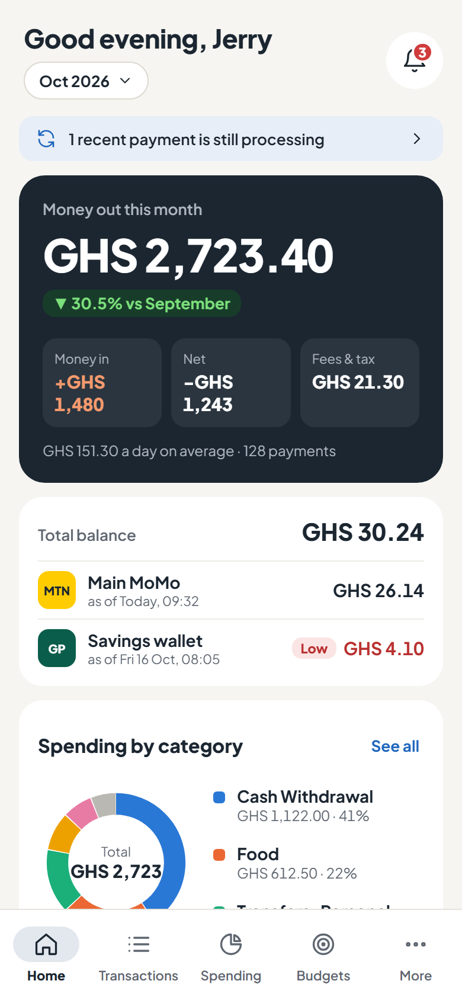
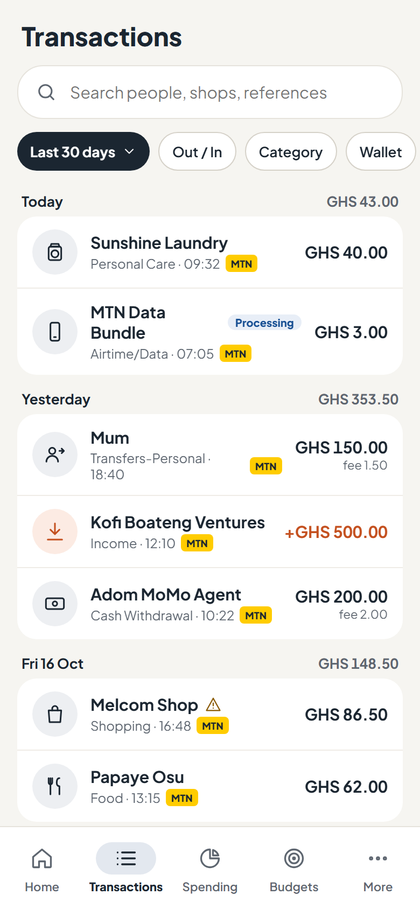
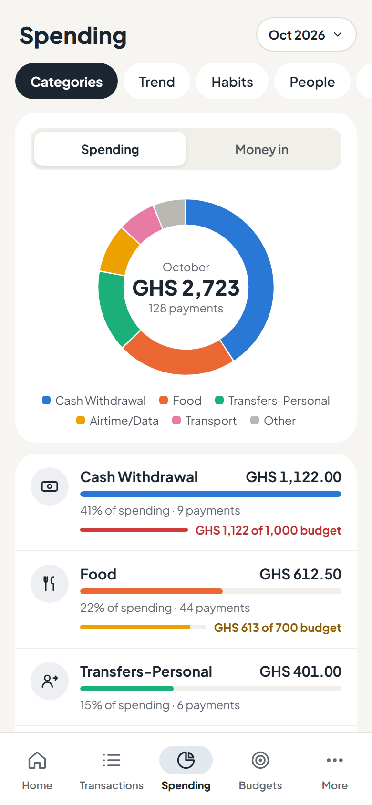
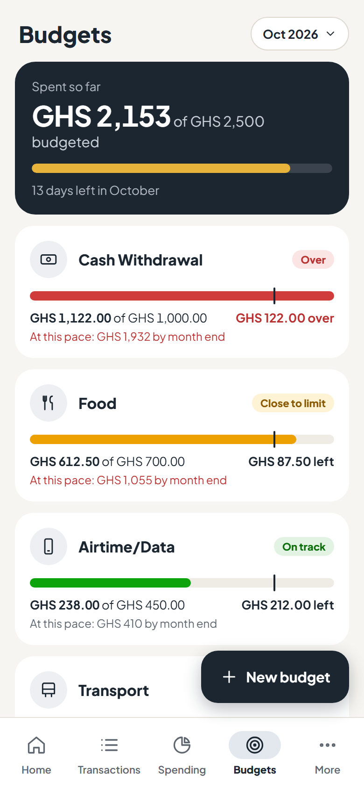

# SikaTrack mobile

The SikaTrack Android app, built with Expo and React Native. Every screen and the endpoint
behind it is described in [docs/ui-spec.md](docs/ui-spec.md).

## What it looks like

The four main tabs, from the design prototype the app was built from. The numbers are sample
data, not a real account.

| Home | Transactions | Spending | Budgets |
| --- | --- | --- | --- |
|  |  |  |  |
| This month's money out against last month, money in, net and fees; each wallet's balance; spending by category, tips and recurring payments | Every payment, newest first, grouped by day with the day's total. "Processing" marks one the pipeline hasn't confirmed yet | Where the money went, by category, with budgets alongside. Trend, Habits, People and Fees are the other views | Each category's limit, what's left, and where this pace ends the month |

The full prototype (every screen, linked as a clickable flow) is the
[SikaTrack App Prototype](https://claude.ai/artifact/YHbxeLPBhLxfbWuPbE8aNT) design canvas.

## Running it

```bash
npm install
npx expo start
```

## Tests

```bash
npm test
```

Tests use Jest (`jest-expo`) and React Native Testing Library. Unit and component tests sit
next to the file they test (`phone.test.ts` beside `phone.ts`). Screen tests live in
`src/__tests__/screens/`, because every file inside `src/app` becomes a route.

## Code layout

The UI follows [Atomic Design](https://atomicdesign.bradfrost.com/chapter-2/): small parts
are combined into bigger ones, and each layer may only import from the layers below it.

```text
src/
├── api/                 HTTP client, the API's JSON types, and the in-app dev server
├── app/                 Pages: expo-router routes. Each one fills a template with real data
├── components/
│   ├── atoms/           Smallest parts: text, view, icon, button, input, badge
│   ├── molecules/       A few atoms doing one job: money amount, category chip, labelled input
│   ├── organisms/       Screen sections: transaction list, budget card, sync strip
│   └── templates/       Page layouts that place organisms, with no real content
├── hooks/               Shared React hooks, including every data query (queries.ts)
├── services/            One file per API area: calls an endpoint, maps it to the app's models
├── theme/               Design tokens (colours, sizes, fonts) that tailwind.config.js reads
└── utils/               Plain functions, e.g. phone number parsing and formatting
```

Each layer may import from its own layer and the layers below it, never from above.

| Layer | May import from | Holds state or fetches data? |
| --- | --- | --- |
| atoms | atoms, `theme`, `hooks` | No |
| molecules | molecules, atoms, `theme`, `hooks` | Local UI state only (focus, animation) |
| organisms | organisms, molecules, atoms, `theme`, `hooks` | Local UI state only |
| templates | organisms, molecules, atoms, `theme` | No |
| pages (`src/app`) | everything | Yes: this is where data is loaded |

Each layer has an `index.ts` that re-exports its components, so imports read
`import { ThemedText } from '@/components/atoms';`. File names are kebab-case
(`money-amount.tsx`), component names PascalCase (`MoneyAmount`).

## Styling

Components are styled with Tailwind classes through
[NativeWind](https://www.nativewind.dev/) (v4): `<View className="flex-row gap-3 rounded-lg bg-surface p-4">`.

- **Tokens:** [tailwind.config.js](tailwind.config.js) builds its theme from
  [src/theme](src/theme), so the classes and the tokens can't drift apart.
- **Colours follow light and dark mode.** Theme colours are CSS variables that the root layout
  switches, so use `bg-surface` or `text-content` and never add `dark:` variants. The names:
  - text colours are `content-*`: `text-content`, `text-content-secondary`;
  - border colours are `line-*`: `border-line`, `border-line-input`;
  - everything else keeps its token name, kebab-cased: `bg-tint-blue`, `text-icon-red`.
- **Fixed colours:** brand and chart colours are the same in both modes: `bg-brand-ink`,
  `text-brand-gold`, `bg-chart-1`.
- **Fonts:** pick a weight with `font-sans`, `font-sans-semibold`, `font-sans-bold` or
  `font-sans-extrabold`. Never set `fontWeight`; each weight is its own font file on Android.
- **Text:** `ThemedText` gives the type styles (`type="caption"`) and theme colours
  (`themeColor="textSecondary"`). For your own font or colour, pass `type="none"` or
  `themeColor="none"` and set it in `className`. Never put two classes for the same property on
  one element: NativeWind doesn't decide between them by order.
- **Sizes:** `inlineRem: 16` in [metro.config.js](metro.config.js) keeps Tailwind's scale in
  real pixels (`p-4` = 16 px). Off-scale values use brackets: `text-[15px] leading-[21px]`.
- **Inline `style` only for what classes can't express:**
  - values computed at runtime (sizes from props, percentages, data colours);
  - animated transforms;
  - native shadows and `elevation`;
  - `fontVariant: ['tabular-nums']`, which NativeWind can't apply on Android.
- **Icons:** they take a colour string, so they still read it from `useTheme()`.
- **Class strings must stay complete words**, not built like `` `bg-${tone}` ``, or Tailwind
  won't see them. Use a lookup object of full class names instead.

## Charts

Every chart has to let you read its numbers, not just its shape. The chart atoms (`BarChart`,
`LineChart`, `Heatmap` in `src/components/atoms`) follow these rules:

- **A y-axis of round values with the unit on top** (`GHS · 4K · 2K · 0`), worked out by
  `niceTicks` in [src/utils/chart-scale.ts](src/utils/chart-scale.ts), plus hairline
  gridlines and a label under each bar or along the line.
- **Exact figures on tap.** Tapping a bar or a day shows its exact amounts under the chart.
  Short charts (fees, a category's six months) write the value over every bar. Heatmap cells
  have their amount written in them.
- **One axis per chart.** Two measures on different scales get two charts, never a second
  y-axis. That's why fees aren't drawn on the Trend chart: they have their own chart under
  **Fees**, and the Trend readout lists them.
- **Colour follows the thing, never its rank.** Categorical colours come from `DataColors`
  in a fixed order. Past five, the rest share the neutral "Other" colour.
- **Screen readers hear every value.** Each bar, cell and point has its own label, e.g.
  `October 2026: out GHS 2,723.40, in GHS 1,480.00`.

## How data reaches a screen

```text
page (src/app) → hook (hooks/queries.ts) → service (services/*.ts) → api.get (api/client.ts) → backend
                                                                                            ↘ dev server
```

- **[api/types.ts](src/api/types.ts)** has the JSON exactly as
  [backend/docs/api-contract.md](../backend/docs/api-contract.md) defines it.
- **[api/client.ts](src/api/client.ts)** sends every request. It turns error responses into an
  `ApiError` that carries `code` and the `X-Request-ID` the error screens show.
- **Services** call one endpoint each and map snake_case JSON to the app's own models, so
  screens never see the wire format.
- **[hooks/queries.ts](src/hooks/queries.ts)** wraps each service in a TanStack Query hook.
  Those hooks handle caching, pull-to-refresh, paging, and refreshing totals after an edit.

### Connecting the real backend

With `EXPO_PUBLIC_API_URL` set, every request goes to the backend in [../backend](../backend):

- **Sign-in:** `/v1/auth/otp/*`, with this phone's device id.
- **Tokens:** kept in the phone's secure store, refreshed automatically when they expire, and
  dropped on sign-out.
- **Config:** `GET /v1/config`.
- **Launch:** checks the app version, then resumes a saved session at Home or at the onboarding
  step not done yet.

Without `EXPO_PUBLIC_API_URL`, requests go to the in-app dev server in
[src/api/dev-server/](src/api/dev-server/), which answers with the same JSON (see
[Running without a backend](#running-without-a-backend)).

**Run it against your local backend:**

1. Start the stack (`docker compose up -d` in `data-engineering/`, then in `backend/`, as its
   README says). The API listens on `127.0.0.1:8000` on your laptop.
2. Let the phone reach that address. The API is bound to the laptop only, so the simplest way
   is a USB cable with USB debugging on, then:

   ```bash
   adb reverse tcp:8000 tcp:8000
   ```

   The phone's `localhost:8000` now reaches the laptop. On the Android emulator, use
   `http://10.0.2.2:8000` instead and skip this step.
3. Start the app pointed at it:

   ```bash
   EXPO_PUBLIC_API_URL=http://localhost:8000 npx expo start
   ```

4. Sign in with your number. In development the backend doesn't send an SMS: it prints the code
   in its log (`docker compose logs -f api` in `backend/`, look for `[DEV ONLY] sign-in code`).
5. To see your existing MoMo history, link it to the new account (backend README, "Link your
   existing data to your account") before uploading any SMS from the app.

### Sign in with Google

The first screen offers what `GET /v1/config → sign_in_methods` lists: **Continue with Google**,
and/or a phone number with a texted code. Google sign-in uses the native
`@react-native-google-signin/google-signin` module (a development or release build; in Expo Go
it says it isn't available) and needs `EXPO_PUBLIC_GOOGLE_WEB_CLIENT_ID`: the **Web** OAuth client
ID from [DEPLOYMENT.md](../DEPLOYMENT.md#0-set-up-sign-in-with-google-once). Google's picker gives
the app an ID token; `POST /v1/auth/google` checks it and signs in. On the dev server it starts a
new account, like the phone stand-in.

### Reading SMS: a development build

Expo Go can't read SMS. The app reads them with its own native module,
[modules/sms-inbox](modules/sms-inbox), which only exists in a build of this app:

- **Permission:** S07 shows Android's READ_SMS prompt. **Sync now** checks it again, since it can
  be turned off in Android settings.
- **First sync (S09):** reads only the senders in `GET /v1/config → momo_senders`, oldest first,
  and uploads them as `initial_scan` in batches within `limits`. Each batch has its own
  `Idempotency-Key`, reused on a retry. If an upload fails, **Try again** carries on after the
  last batch the server took.
- **Sync now:** sends what came after the server's `latest_date_ms`, less ten minutes, as
  `incremental`. The server skips the ones it already has.

In Expo Go, `canReadSms` is false ([src/services/sms-inbox.ts](src/services/sms-inbox.ts)): the
prompt says yes, and the first sync finds no SMS against a real backend (or plays its stand-in on
the dev server).

**Build it on your phone** (once, then the same fast reload as Expo Go):

1. Use JDK 17, for example Android Studio's own: in PowerShell,
   `$env:JAVA_HOME = "C:\Program Files\Android\Android Studio\jbr"`.
2. With the phone on USB (`adb devices` lists it) and `adb reverse tcp:8000 tcp:8000` done:

   ```bash
   EXPO_PUBLIC_API_URL=http://localhost:8000 npx expo run:android
   ```

   The first build takes several minutes. It generates `android/` (not committed: it's rebuilt
   from `app.json` and the modules) and installs **SikaTrack** next to Expo Go.
3. After that, `npx expo start` serves the code to the installed build. Rebuild only when native
   code or `app.json` changes.

**Before Google Play:** READ_SMS is a restricted permission. Play only publishes the app after
its Permissions Declaration is approved, which needs a privacy policy and a short video of the
SMS feature. The Android package is `app.sikatrack`; it can't change once the app is on Play.

**What still needs work in a development build:**

- **Push notifications:** `PUT /v1/devices/{id}` with the push token needs `expo-notifications`.
- **Notification prompts:** the notification prompt, and checking whether Android allows
  notifications, answer "allowed" until then.
- **A phone with no MoMo SMS:** the backend only marks the first sync done after an upload with
  at least one message, so such a phone resumes at the first-sync step on each launch.

- **Coming-soon features have real screens:**
  - **Export my data** explains the export. Its button turns on when `GET /v1/config` sends
    `features.export: true`.
  - **Unsupported providers** (`supported: false`) open a page on what still works.
- **Terms of use** (`src/app/terms.tsx`) is a plain-language first draft. It needs a legal
  review before release.
- **Links from outside the app** (push notifications) go through `src/app/+native-intent.tsx`,
  which uses the same table as in-app links (`src/utils/deep-links.ts`).
  `src/__tests__/navigation.test.ts` fails if any link points at a missing screen or a screen
  can't be reached.

## Running without a backend

Until the API exists, the dev server and the stand-in services keep their data in memory, so
everything starts over when the app reloads.

**Sign-in** lets everyone through:

- Any valid number gets a code, and any code signs in, except `000000`. That one is rejected
  so you can see the wrong-code state.
- Every sign-in starts a new account, which then goes through onboarding.
- People can sign in from the countries in `supportedCountries` in
  [src/services/config.ts](src/services/config.ts). Any other country can be chosen, but it
  shows a "not available yet" note.

**Onboarding** goes through every step:

- **SMS and notifications:** both permission prompts answer yes. Real ones need a development
  build.
- **Wallets:** the sign-in number is prefilled for the first wallet. Adding the same wallet
  twice shows the "already on your account" error. There are no "Is this you?" name
  suggestions yet, because those come from reading the SMS.
- **First sync:** it replays a scan of the dataset the pipeline was built on, over about 6
  seconds.

**Budgets, wallets and recurring payments** start from sample data in
[src/api/dev-server/catalog.ts](src/api/dev-server/catalog.ts):

- **Budgets:** four budgets. Creating, editing and deleting them works until the app reloads.
  The Budgets tab hides when `features.budgets` is off in `services/config.ts`.
- **Wallets:** two sample wallets. Balances and the balance history come from their
  transactions.
- **Recurring:** five series, one for each state. DStv and MTN Bundle are expected. Netflix is
  planned to cancel but still charging. Kwesi Ofori is waiting for review. Boomplay has
  stopped.

To see the edge cases, start the app with one of these:

| Command | Shows |
| --- | --- |
| `EXPO_PUBLIC_FORCE_UPDATE=true npx expo start` | The update-required screen |
| `EXPO_PUBLIC_EMPTY_INBOX=true npx expo start` | No MoMo SMS: an empty first sync, an empty month on Home, and no transactions |
| `EXPO_PUBLIC_DEV_API_FAILURE=true npx expo start` | Every dev server request failing: the error states with **Try again** and a request ID |
| `EXPO_PUBLIC_DEV_API_FAILURE=unavailable npx expo start` | The servers away (503): "SikaTrack is taking a break" |
| `EXPO_PUBLIC_DEV_API_FAILURE=rate_limited npx expo start` | Too many requests: the "Slow down a little" toast |
| `EXPO_PUBLIC_DEV_API_FAILURE=session_expired npx expo start` | The session gone: the "Please sign in again" dialog |
| `EXPO_PUBLIC_DEV_API_FAILURE=update_required npx expo start` | The app too old for the server: the update-required screen |
| Airplane mode | The "You're offline · showing saved data" banner over saved screens |
